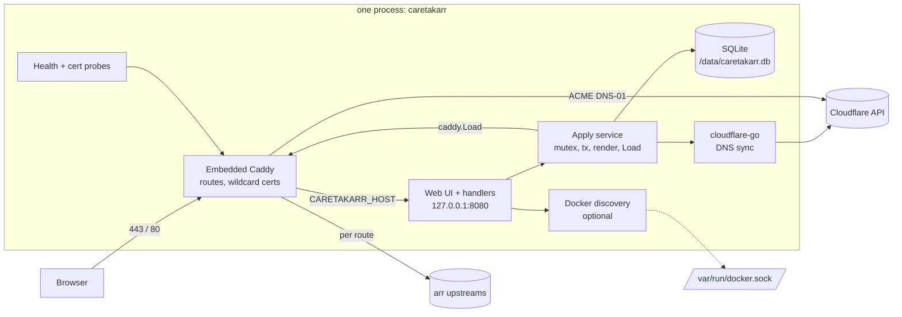
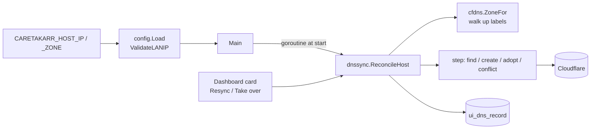
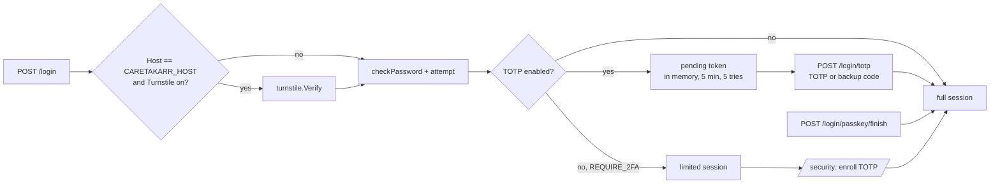

# Caretakarr — Architecture

Status: draft from `/sc:design`. Inputs: `docs/REQUIREMENTS.md`. Next: `/sc:workflow` to produce `IMPLEMENTATION_PLAN.md`.

## 1. Decisions closing the requirements' open questions

| Question | Decision |
|---|---|
| A-record IP | Per-domain default IP, user-entered, overridable per route. No auto-detect. |
| Orange cloud | Not supported. Records are always DNS-only (`proxied=false`). |
| DNS on route delete | Delete only records Caretakarr created (`owned=1`). Adopted records are never modified or deleted. |
| ACME CA | `ACME_STAGING` env. Default production. Dev compose file sets it `true`. Read-only in UI. |
| Import/export | Out of v1. `/data/caretakarr.db` copy is the backup. |
| UI hostname cert | `CARETAKARR_HOST` always gets its own exact-name cert policy, independent of the DB. It does not need to be a managed domain. |

## 2. Verified facts the design relies on

- `caddy.Load(cfgJSON []byte, forceReload bool) error` swaps config atomically, restores the old one on failure, installs no signal handler. We own signals. (Source: `caddy.go`, high confidence.)
- `caddy.Load` autosaves unless `admin.config.persist=false`. We set it false, since SQLite is the source of truth. Verify field names in the spike.
- Caddy 2.10+ serves matching subdomains from one wildcard cert.
- Websocket and `X-Forwarded-*` handling is automatic in `reverse_proxy`.
- `cloudflare-go` latest major is **v7** (`github.com/cloudflare/cloudflare-go/v7`, v7.13.0 on 2026-10-12). Context7's v4.5.1 listing is stale. `option.WithBaseURL` lets tests point it at `httptest`, so no DNS interface is needed.
- `caddy-dns/cloudflare` token: `Zone:Read` + `DNS:Edit`. The same token drives `cloudflare-go`, so one token serves both.

## 3. Components



The UI listens only on loopback. Caddy proxies `CARETAKARR_HOST` to it, so the UI gets the same TLS as everything else. Optional `UI_LISTEN` (default `127.0.0.1:8080`) can be set to `0.0.0.0:8080` and published for recovery when Caddy is broken. Document this as an auth bypass if `ADMIN_PASSWORD` is unset.

### Package layout

```
cmd/caretakarr/main.go        wiring, signals, graceful shutdown
internal/config/              env parsing + validation (fail fast)
internal/store/               modernc.org/sqlite, embedded SQL migrations, queries
internal/caddycfg/            pure func: (State, Options) -> []byte JSON
internal/apply/               mutex + tx + render + caddy.Load + DNS reconcile
internal/cfdns/               zone lookup, A record upsert/delete/adopt
internal/web/                 handlers, templates/, static/ (embed.FS), auth, CSRF
internal/presets/             static slice of arr services + default ports
internal/discovery/           Docker /containers/json over unix socket (stdlib)
internal/probe/               TCP upstream check, loopback TLS cert probe
```

Choices: `modernc.org/sqlite` is pure Go, so `CGO_ENABLED=0` gives a static, multi-arch binary with no toolchain pain. Docker discovery uses stdlib HTTP over the unix socket, which avoids the moby client dependency tree.

## 4. Data model

```sql
CREATE TABLE domains (
  id         INTEGER PRIMARY KEY,
  name       TEXT NOT NULL UNIQUE,         -- example.com
  zone_id    TEXT NOT NULL,                -- Cloudflare zone, resolved on add
  default_ip TEXT NOT NULL,                -- A-record target
  cert_mode  TEXT NOT NULL DEFAULT 'wildcard' CHECK (cert_mode IN ('wildcard','per_host')),
  created_at TEXT NOT NULL DEFAULT CURRENT_TIMESTAMP
);

CREATE TABLE routes (
  id              INTEGER PRIMARY KEY,
  domain_id       INTEGER NOT NULL REFERENCES domains(id) ON DELETE RESTRICT,
  subdomain       TEXT NOT NULL,           -- sonarr
  scheme          TEXT NOT NULL DEFAULT 'http' CHECK (scheme IN ('http','https')),
  upstream_host   TEXT NOT NULL,
  upstream_port   INTEGER NOT NULL CHECK (upstream_port BETWEEN 1 AND 65535),
  tls_skip_verify INTEGER NOT NULL DEFAULT 0,
  enabled         INTEGER NOT NULL DEFAULT 1,
  record_ip       TEXT,                    -- NULL = domain default_ip
  allowlist       TEXT NOT NULL DEFAULT '',-- newline-separated CIDRs, '' = open
  basic_user      TEXT,
  basic_hash      TEXT,                    -- bcrypt; both NULL = no auth
  preset          TEXT,
  UNIQUE (domain_id, subdomain)
);

CREATE TABLE dns_records (
  route_id     INTEGER PRIMARY KEY REFERENCES routes(id) ON DELETE CASCADE,
  cf_record_id TEXT,
  content      TEXT,                       -- IP last synced
  owned        INTEGER NOT NULL DEFAULT 1, -- 0 = adopted, never touch
  state        TEXT NOT NULL DEFAULT 'pending' CHECK (state IN ('pending','synced','error','conflict')),
  error        TEXT,
  synced_at    TEXT
);
```

Migrations: `internal/store/migrations/NNN_name.sql` embedded, applied in order, tracked with `PRAGMA user_version`. No migration library. Open DB with WAL, `foreign_keys=ON`, `busy_timeout`.

Secrets never stored: no CF token, no admin password. Basic-auth stores only a bcrypt hash.

## 5. Caddy config generation

`caddycfg.Render(state State, opts Options) ([]byte, error)` is pure and golden-file tested. `Options{UIHost, UIUpstream, Email, Staging, HTTPPort, HTTPSPort, StoragePath, Issuer}` where `Issuer` is `ACME` (prod/staging) or `Internal` (tests only).

```jsonc
{
  "admin": { "disabled": true, "config": { "persist": false } },
  "storage": { "module": "file_system", "root": "/data/caddy" },
  "apps": {
    "http": {
      "http_port": 80, "https_port": 443,
      "servers": { "srv0": {
        "listen": [":443"],
        "routes": [
          // 1. UI route (always present, first)
          { "match": [{"host": ["caretakarr.example.com"]}],
            "handle": [{"handler":"reverse_proxy","upstreams":[{"dial":"127.0.0.1:8080"}]}],
            "terminal": true },
          // 2. one per route
          { "match": [{"host": ["sonarr.example.com"]}],
            "handle": [{ "handler": "subroute", "routes": [
              { "match": [{"not":[{"remote_ip":{"ranges":["192.168.0.0/16"]}}]}],
                "handle": [{"handler":"static_response","status_code":"403"}], "terminal": true },
              { "handle": [{"handler":"authentication","providers":{"http_basic":{
                  "hash":{"algorithm":"bcrypt"},
                  "accounts":[{"username":"u","password":"$2a$..."}]}}}] },
              { "handle": [{"handler":"reverse_proxy","upstreams":[{"dial":"192.168.1.20:8989"}],
                  "transport":{"protocol":"http"}}] }
            ]}], "terminal": true }
        ]
      }}
    },
    "tls": { "automation": { "policies": [
      { "subjects": ["*.example.com"], "issuers": [ACME_ISSUER] },
      { "subjects": ["caretakarr.example.com"], "issuers": [ACME_ISSUER] }
    ]}}
  }
}
```

`ACME_ISSUER`:
```jsonc
{ "module": "acme", "email": "<ACME_EMAIL>", "ca": "<staging URL, omitted for prod>",
  "challenges": { "dns": {
    "provider": { "name": "cloudflare", "api_token": "{env.CLOUDFLARE_API_TOKEN}" },
    "propagation_delay": "<ACME_PROPAGATION_DELAY, omitted if unset>",
    "propagation_timeout": "<ACME_PROPAGATION_TIMEOUT, omitted if unset>",
    "resolvers": ["1.1.1.1", "8.8.8.8"] } } }
```

This is the JSON equivalent of the homelab Caddyfile's `tls { dns cloudflare {$CLOUDFLARE_API_TOKEN}; propagation_timeout 10m; propagation_delay 2m; resolvers 1.1.1.1 8.8.8.8 }`. `propagation_delay` and `propagation_timeout` are optional: emitted only if `ACME_PROPAGATION_DELAY` / `ACME_PROPAGATION_TIMEOUT` are set (the homelab values were `2m` / `10m`). `resolvers` comes from `ACME_RESOLVERS`, default `1.1.1.1,8.8.8.8`. The `{$VAR}` form in a Caddyfile is substituted at parse time. The JSON `{env.VAR}` placeholder is resolved at runtime, so the rendered JSON never contains the token. Field names `propagation_delay`, `propagation_timeout`, `resolvers` sit on `challenges.dns` (confirmed in Caddy's ACME issuer JSON reference: `challenges.dns` = `provider`, `ttl`, `propagation_delay`, `propagation_timeout`, `resolvers`, `override_domain`). Caddy defaults when omitted: timeout 2 minutes, delay 0. `email` sits on the `acme` issuer next to `ca`; it comes from the required `ACME_EMAIL`.

Cert mode, per domain (`domains.cert_mode`):
- `wildcard` (default): TLS policy `subjects: ["*.example.com"]`. One issuance per domain, so adding routes costs none, and subdomain names stay out of CT logs.
- `per_host`: TLS policy `subjects` lists that domain's enabled route hostnames (`["banking.example.com", …]`), matching the plain Caddyfile behavior. Each new route triggers a new issuance and pays any configured propagation delay.
- Empty `per_host` domain (no routes) emits no policy. Hostnames are sorted for deterministic output.

Migration check for the homelab case: `banking.example.com` → domain `example.com`, route `banking`, upstream `192.168.25.165:8766` over `http`. The renderer must produce the same behavior as that Caddyfile (golden test).

Rules:
- The token is the placeholder `{env.CLOUDFLARE_API_TOKEN}`, never the literal, so rendered JSON is safe to log.
- Disabled route: omitted from the rendered config entirely (no handler, no TLS policy subject), so Caddy does no certificate work for it. Its DNS record and DB row are kept.
- Order: UI route first, then routes by subdomain (deterministic output for golden tests and for `Load`'s same-config short-circuit).
- Both `http_port`/`https_port` come from `Options`, so integration tests use high ports.
- Tests use `Issuer=Internal` (`{"module":"internal"}`) plus `pki.certificate_authorities.local.install_trust=false`. No real ACME or Cloudflare in tests.
- Zone names ending `.local`, `.internal`, `.home.arpa`, and IP literals are rejected at domain-add (validated in `internal/config` helper, tested).

## 6. Apply path (the only way config changes)

```mermaid
sequenceDiagram
  participant H as web handler
  participant A as apply (global mutex)
  participant S as SQLite tx
  participant C as caddy.Load
  participant D as cfdns
  H->>A: Mutate(fn)
  A->>S: BEGIN, fn(tx)
  A->>A: state = read(tx); json = Render(state)
  A->>C: Load(json, false)
  alt Caddy rejects
    C-->>A: error
    A->>S: ROLLBACK
    A-->>H: error (exact text, shown in UI)
  else ok
    A->>S: COMMIT
    A->>D: Reconcile(routes needing DNS)
    D-->>A: per-route state (synced / error / conflict)
    A->>S: update dns_records
    A-->>H: ok + DNS states
  end
```

- `// ponytail: global mutex; per-domain locks if concurrent admin edits ever matter.`
- DNS is not transactional with SQLite. A DNS failure does not revert the route. The route works if the record exists, and `dns_records.state='error'` shows a retry button.
- Startup: render from DB and `Load`. If that fails, load the **bootstrap-only config** (UI route + UI cert policy) and show a persistent banner with the error, so the user can fix data from the UI.
- Commit failing after a successful `Load` is rare. Handle by re-rendering from the DB and `Load`ing again, then returning the error.

## 7. DNS sync (`cfdns`, `cloudflare-go/v7`)

- Domain add: `Zones.List(name=…)` → `zone_id`. Failure means token lacks access or zone not in account: reject with that message.
- Startup: verify token (`User.Tokens.Verify`). Bad token → UI banner, no crash.
- Reconcile one route: name = `sub.domain`, content = `record_ip ?? default_ip`.
  - No stored record id: `DNS.Records.List(type=A,name=…)`.
    - none → create (`proxied=false`, `comment="managed by caretakarr"`), `owned=1`.
    - exists, same content → adopt, `owned=0`, `state=synced`.
    - exists, different content → `state=conflict`, no write, UI offers "Take over" (updates and sets `owned=1`).
  - Stored id, content changed → update (only if `owned=1`).
- Delete route: if `owned=1` delete the record, else leave it. Always confirm in UI and say which.
- No periodic drift detection in v1. A "Resync" button covers it.

## 8. Web layer

- stdlib `net/http` with Go 1.22+ `ServeMux` patterns. `html/template` pages and partials, htmx swaps. Assets in `embed.FS`. Pico CSS vendored, no CDN at runtime.
- Pages: `/` dashboard (domains, routes, status), `/domains`, `/routes/new`, `/routes/{id}`, `/login`, `/status` (health fragment, polled every 10s with htmx).
- Auth (if `ADMIN_PASSWORD` set): constant-time compare, signed session cookie (`HttpOnly`, `Secure`, `SameSite=Strict`, 12h), key generated per boot (restart logs everyone out; fine). In-memory per-IP login throttle.
- CSRF: `SameSite=Strict` plus reject non-GET without `HX-Request` or with a mismatched `Origin`.
- Unset password: all requests pass, a startup `WARN` log, and a red dashboard banner.
- Client IP for throttling comes from `X-Forwarded-For` only when the peer is loopback (i.e. from Caddy).
- Upstream form: preset dropdown fills subdomain and port. Docker discovery panel appears only if the socket exists.

## 9. Status and probes

- **Upstream health:** TCP dial every 30s per enabled route, kept in memory, shown as up/down.
- **Cert state:** loopback TLS dial to `127.0.0.1:443` with SNI = route host, `InsecureSkipVerify`, read leaf `NotAfter` and issuer. Handshake failure → "pending/error". Tests the real serving path with no Caddy internals.
- **Logs (v1):** ACME failure reasons live in Caddy logs, so a registered Caddy log writer module (`caddy.logging.writers.caretakarr`) feeds an in-memory ring buffer (e.g. 1000 lines) shown on a Logs page, filterable by level, polled by htmx. Config adds a `logging.logs.default` with that writer. This prevents the "pending forever" dead end. Not persisted. 

Writer module shape (modeled on Caddy's built-in `caddy.logging.writers.file`/`stdout`):
```go
package caddylog

var Sink = NewRing(1000) // set up by main before caddy.Load; also read by the web layer

func init() { caddy.RegisterModule(Writer{}) }

type Writer struct{}

func (Writer) CaddyModule() caddy.ModuleInfo {
	return caddy.ModuleInfo{ID: "caddy.logging.writers.caretakarr", New: func() caddy.Module { return new(Writer) }}
}
func (Writer) String() string                      { return "caretakarr" }
func (Writer) WriterKey() string                   { return "caretakarr:ring" }  // constant: pooled, survives reloads
func (Writer) OpenWriter() (io.WriteCloser, error) { return nopCloser{Sink}, nil } // Close is a no-op, never closes the ring

var _ caddy.WriterOpener = (*Writer)(nil)
```
Rendered config: `"logging":{"logs":{"default":{"writer":{"output":"caretakarr"},"encoder":{"format":"json"},"level":"INFO"}}}`. The ring parses each JSON line, keeps `ts`, `level`, `logger`, `msg`, and the error field. `Write` must not block (mutex-guarded slice, drop oldest). Import the package for side effects in `main`. Spike acceptance: render config with this writer, `Load`, trigger an ACME failure (bad token against staging), see the line in `Sink`; reload twice and confirm the ring still receives lines.

Because `Sink` is a package global, tests that assert on log lines run serially along with the other Caddy integration tests.

## 10. Docker discovery (opt-in)

`GET http://unix/containers/json` over `/var/run/docker.sock`. Show name, image, exposed private ports, networks. Pre-fill route with the container name as the upstream host (resolvable only if on a shared user-defined network; the UI says so). Docs recommend a read-only socket proxy (e.g. `tecnativa/docker-socket-proxy`) instead of the raw socket.

## 11. Build and runtime

```
builder: golang:<ver>  CGO_ENABLED=0 go build -trimpath -ldflags="-s -w"
final:   gcr.io/distroless/static:nonroot  (has CA certs; UID 65532)
/data volume; ports 80, 443, 443/udp (HTTP/3)
```

- Non-root can bind 80/443 because Docker ≥20.10 sets `ip_unprivileged_port_start=0`. Document that `/data` must be writable by UID 65532.
- `docker-compose.yml`: caretakarr service, `./data:/data`, `.env`. Optional commented socket mount. `docker-compose.dev.yml` sets `ACME_STAGING=true`.
- Module path `github.com/caretakarr/caretakarr`. GitHub Actions: `make check`, then multi-arch (amd64, arm64) image build to `ghcr.io/caretakarr/caretakarr` on tag.
- Dependencies (`caddyserver/caddy/v2`, `caddy-dns/cloudflare`, `cloudflare-go/v7`) pinned in `go.mod` at the latest stable tags when slice 0 starts. Renovate or Dependabot bumps afterward.
- Ship `LICENSE` (MIT) and `NOTICE` (Caddy, caddy-dns/cloudflare: Apache-2.0).

## 12. Test strategy per component

| Component | Layer | Approach |
|---|---|---|
| `caddycfg` | unit | Golden JSON for: empty DB (bootstrap), one route, disabled, allowlist, basic auth, staging vs prod issuer, wildcard vs per_host, delay/timeout set vs unset, the `banking.example.com` homelab case |
| `store` | unit | In-memory SQLite, migrations apply cleanly, constraints (unique, port range) |
| `config` | unit | Env parsing, rejects bad hostnames and `.local`-style domains |
| `cfdns` | unit | `httptest` server + `WithBaseURL`: create, adopt, conflict, owned-delete, adopted-no-delete |
| `apply` | integration | Real in-process Caddy on high ports, `Issuer=Internal`, `httptest` upstream: route works, bad config rolls back DB and keeps old route live, websocket upgrade passes |
| `web` | unit + e2e | Handler tests for auth/CSRF/throttle; Playwright for add-domain, add-route-from-preset, toggle, delete-with-confirm |
| startup | integration | Corrupt route row → bootstrap-only fallback + banner |

Caveat: embedded Caddy is process-global (`caddy.Load` uses package state). Integration tests must run serially and call `caddy.Stop()` in cleanup.

## 13. Risks and mitigations

| Risk | Level | Mitigation |
|---|---|---|
| Process-global Caddy state in tests | moderate | Serial integration package, `caddy.Stop()` cleanup |
| `admin.disabled` / `config.persist` field names | low | Spike confirms against current Caddy before slice 1 |
| Config in DB makes Caddy unable to start | moderate | Bootstrap fallback (§6) |
| Open UI footgun | moderate | Warning log + red banner; document `ADMIN_PASSWORD` |
| Docker socket = host root | high if enabled | Opt-in, docs push socket proxy |
| Wildcard issuance slow or failing silently | moderate | Cert probe and Logs page (§9) |
| Custom Caddy log writer module registration | low | Spike confirms; fallback is `docker logs` |
| `modernc.org/sqlite` perf | low | Workload is a few rows |

## 14. Suggested slices (for `/sc:workflow`)

0. **Spike:** embed Caddy, `Load` a static JSON with `internal` issuer, curl a route, confirm admin disabled and persist off. Throwaway test becomes the integration harness.
1. `config` + `store` + migrations.
2. `caddycfg` renderer with bootstrap config (golden tests).
3. `apply` service + real-Caddy integration test (UI host route).
4. Web skeleton: layout, auth, CSRF, dashboard.
5. Domains: Cloudflare zone lookup (`cfdns` part 1).
6. Routes + presets + apply; website routing works end to end.
7. DNS record sync (create / adopt / conflict / owned delete).
8. Route controls: toggle, allowlist, basic auth.
9. Probes and status UI.
10. Docker discovery (opt-in).
11. Caddy log ring buffer + Logs page.
12. Dockerfile, compose, CI, docs, license/NOTICE.

## 15. Explicit non-goals (v1)

Orange-cloud records, DDNS/public-IP detection, multi-user accounts, path-based routing, import/export, `trusted_proxies` configuration, drift detection loop, non-Cloudflare DNS providers, public-IP records, IPv6/AAAA.

## 16. UI host record and LAN-only IPs

Source: brainstorm of 2026-10-14. Servers with several addresses need `CARETAKARR_HOST` to resolve to a chosen one, so Caretakarr manages that A record itself. Issuance is unaffected (DNS-01 needs no IP) and Caddy keeps listening on all interfaces.

### 16.1 Decisions
| Topic | Decision |
|---|---|
| `CARETAKARR_HOST_IP` | Required. IPv4 in 10/8, 172.16/12, 192.168/16 or 100.64/10 (CGNAT, Tailscale). Anything else fails startup naming the variable. |
| `CARETAKARR_HOST_ZONE` | Optional zone name override. Unset: walk labels up from the host, never below two labels, first zone the token can see. |
| Same rule everywhere | Domain `default_ip` and route `record_ip` use the same validator. Public IPs are out of scope for the whole product. |
| Record lifecycle | Same owned / adopt / conflict rules as routes. Reconciled in the background at each start and from dashboard buttons. Never deleted automatically. |
| Collision | A route whose `subdomain.domain` equals `CARETAKARR_HOST` is rejected (the UI route always wins in Caddy, so it could never be served). |

### 16.2 Components


- `config.ValidateLANIP(s) (netip.Addr, error)`: `Is4()` and (`IsPrivate()` or inside `100.64.0.0/10`). The error names the value and lists the allowed ranges. Test table covers every range boundary (`172.15.255.255` no, `172.16.0.0` yes, `172.31.255.255` yes, `172.32.0.0` no, `100.63.255.255` no, `100.64.0.0` yes, `100.127.255.255` yes, `100.128.0.0` no), loopback, link-local, unspecified, multicast, public, IPv6.
- Call sites: `config.Load` (host IP), `addDomain` (replaces the current `Is4` check), and `parseRoute` for a new `record_ip` form field. That field has no UI today, and the edit handler comment already says the override is "edited elsewhere"; this adds it to the route form and overlays it in `updateRoute`.
- `cfdns.ZoneFor(ctx, host, override) (zoneID, zoneName string, err)`. `ZoneID` gains a sentinel `ErrZoneNotFound`, so the walk continues only on not-found and aborts on API errors (bad token). Final error lists the names tried.
- `dnssync.step` is reused unchanged. `ReconcileHost(ctx, takeOver bool)` resolves the zone, builds `name = CARETAKARR_HOST`, `want = CARETAKARR_HOST_IP`, runs `step` with the stored row, and upserts. Failures become `state=error`, never a returned error and never fatal, matching routes. `Syncer` receives `HostSpec{Name, IP, ZoneOverride}` at construction.
- `ReconcileHost` runs in a goroutine in `main` next to `VerifyToken`, so startup and the bootstrap fallback never wait on Cloudflare.

### 16.3 Data
Migration `002_ui_dns.sql`. A route-independent twin of `dns_records`, constrained to one row:
```sql
CREATE TABLE ui_dns_record (
  id           INTEGER PRIMARY KEY CHECK (id = 1),
  cf_record_id TEXT,
  content      TEXT,
  owned        INTEGER NOT NULL DEFAULT 1,
  state        TEXT NOT NULL DEFAULT 'pending' CHECK (state IN ('pending','synced','error','conflict')),
  error        TEXT,
  synced_at    TEXT
);
```
Store gets `GetUIDNS` / `UpsertUIDNS` reusing the `DNSRecord` struct (`RouteID` unused). The zone is re-resolved on every reconcile, so it is not stored. Chosen over making `dns_records.route_id` nullable: that would weaken the FK and cascade that routes rely on.

### 16.4 Web
- Dashboard card above the routes table: host, IP, state, error text, and Resync / Take over buttons (same states and wording as route rows).
- `POST /host/dns/resync`, `POST /host/dns/takeover`, both CSRF-guarded and behind login, answering `HX-Redirect: /`.
- `checkRoute` (inside the apply tx) rejects `subdomain + "." + domain.Name == cfg.Host` with 422 and a clear message.

### 16.5 Edge cases
- Host under an unmanaged zone: works, since the zone comes from Cloudflare, not from the domains table.
- Host's zone is also a managed domain: routes there are unaffected apart from the collision rule.
- Token lacks the zone: state `error` with the tried names; the UI still serves from the bootstrap/normal config.
- Existing rows with public IPs (none expected): no crash. Reconcile does not re-validate stored rows; the dashboard may show a notice.
- Owned record, IP changed in env, restart: updated. Adopted record: becomes `conflict`, never written.

### 16.6 Test plan
| Layer | Cases |
|---|---|
| `config` | `ValidateLANIP` boundary table; `CARETAKARR_HOST_IP` missing / public / IPv6 fails naming the variable; `CARETAKARR_HOST_ZONE` must be a suffix of the host |
| `cfdns` | `ZoneFor`: found at each level, none found lists tried names, override used verbatim, API error aborts the walk |
| `dnssync` | host record: create, adopt, conflict then take over, IP change on owned, adopted untouched, API error, idempotent resync, zone not found |
| `store` | migration 002 on fresh and v1 DBs; one-row constraint |
| `web` | card renders each state; resync and take over endpoints; collision rejection; `record_ip` accepted/rejected; domain add rejects public IP |
| e2e | card shows synced; seeded conflict taken over; route named like the host is rejected |

### 16.7 Risks
| Risk | Level | Mitigation |
|---|---|---|
| A later need for public-IP records | low, accepted | The validator is one function; a switch would be additive |
| Zone walk picks a parent zone the user did not intend | low | `CARETAKARR_HOST_ZONE` override; tried names shown on error |
| Behavioral change for domains/routes (public IPs now rejected) | low | No installs yet; error message lists allowed ranges |

## 17. Admin login hardening: TOTP, passkeys, Turnstile

Source: brainstorm of 2026-10-15; modelled on `../gochatserver` (`service/totp.go`, `service/passkeys.go`, `service/turnstile.go`). Single admin, no users table. Everything is inert when `ADMIN_PASSWORD` is unset.

### 17.1 Decisions
| Topic | Decision |
|---|---|
| Passkey role | Passwordless alternative. A passkey login is a full session, no TOTP prompt. Password (+TOTP) stays as fallback. |
| Storage | SQLite (migration `004_2fa.sql`). The env-only secrets rule covers operator secrets only (`CLOUDFLARE_API_TOKEN`, `ADMIN_PASSWORD`, `CARETAKARR_SECRET_KEY`, `TURNSTILE_SECRET`). Enrolled credentials live in the DB. |
| TOTP seed | AES-256-GCM, key = HKDF-SHA256(`CARETAKARR_SECRET_KEY`). Backup codes: SHA-256 hex (high entropy, no bcrypt). Passkey public keys: plain. |
| Turnstile | Opt-in. Password step only. Enforced only when the request `Host` equals `CARETAKARR_HOST`; the `UI_LISTEN` recovery listener (LAN IP / localhost Host) is exempt. |
| Passkey RP | RP ID = hostname of the request `Host`, accepted only if it equals `CARETAKARR_HOST` or is `localhost`. Origin = `https://` or `http://` (localhost only) + `Host`, port included. No new env var. Deviation from the brainstorm ("from `CARETAKARR_HOST`" only): `localhost` is a secure context, so on-box recovery and e2e can use passkeys. |
| Enforcement | `REQUIRE_2FA=true`: a password login without TOTP yields a *limited* session (only `/security`, `/logout`, static) until TOTP is confirmed. Passkey login is always full. Needs `ADMIN_PASSWORD` and `CARETAKARR_SECRET_KEY`, else startup fails. |
| Recovery | Backup codes; `caretakarr 2fa-reset` wipes TOTP, backup codes, passkeys. It reads only `DATA_DIR`, not the full config. Run it with `docker compose run --rm` (a stopped or restarting container cannot `exec`). Sessions are stateless, so restart to drop live ones. |
| Audit | `slog` only: event, method, never codes, seeds or tokens. |
| Skipped | Passkey rename (delete and re-add), mobile handoff, API tokens, audit table, "recently verified" state. |

### 17.2 Config (`internal/config`)
| Env | Rule |
|---|---|
| `CARETAKARR_SECRET_KEY` | Optional, at least 32 chars. Unset: TOTP enrollment disabled in UI (hint explains); passkeys and Turnstile still work. |
| `REQUIRE_2FA` | Bool. True needs `ADMIN_PASSWORD` and `CARETAKARR_SECRET_KEY`; error names the missing variable. |
| `TURNSTILE_SITE_KEY`, `TURNSTILE_SECRET` | Both or neither; one alone fails startup naming the other. With no `ADMIN_PASSWORD`: warn, inert. |
| `TURNSTILE_BASE_URL` | Test hook only (like `CLOUDFLARE_BASE_URL`): siteverify endpoint override. |

### 17.3 Components


New code, all in existing packages unless noted:
- `internal/secretbox` (new, ~40 lines): `Seal(key, plaintext)` / `Open(key, blob)`, random 12-byte nonce prepended, fixed AAD. Wrong key and tampering return an error.
- `internal/web/turnstile.go`: port of gochat's `Turnstile.Verify`. Fails closed. Checks `success`, `action == "login"`, and `hostname == CARETAKARR_HOST` (always pinned). Client IP from `clientIP`.
- `internal/web/totp.go`: `pquerna/otp/totp` (SHA1, 6 digits, 30 s, skew 1). Accepts a code only for a step greater than stored `last_step` (replay). Backup codes: 10 random codes shaped `xxxxx-xxxxx`, stored as SHA-256 hex, marked used atomically (`UPDATE ... WHERE used_at IS NULL`, check rows affected).
- `internal/web/passkeys.go`: `go-webauthn/webauthn` built per request from the RP rule above. A `webauthn.User` adapter for the one admin: fixed handle `"caretakarr-admin"`, name `admin`, credentials loaded from the DB filtered by `rp_id`. Attestation `none`, resident key required, user verification required, existing credentials excluded on registration, cap 10. `CloneWarning` rejects and logs. Sign count, backup state and `last_used_at` persisted after each login.
- `authn` (`auth.go`): `newCookie` takes a level (`full` or `enroll`); payload `exp` or `exp:e`, signed. `valid` returns the level. New in-memory maps behind the existing mutex: `pending` (token to expiry, tries) and `ceremonies` (id to `SessionData`, kind, expiry; capped at 64, expired entries swept on insert). Single use: `take` deletes on read. A restart drops both, which just restarts the login.
- `protected(h)`: unchanged signature. Adds: level `enroll` may only reach `/security*`, `/logout`; anything else redirects to `/security`. `REQUIRE_2FA` is enforced by the cookie level, not by a DB query per request.
- Throttle: reuse `attempt(ip)` with separate buckets: `ip` (password and TOTP step) and `pk:`+`ip` (passkey begin/finish).

### 17.4 Data (`004_2fa.sql`)
```sql
CREATE TABLE totp (
  id        INTEGER PRIMARY KEY CHECK (id = 1),
  secret    BLOB NOT NULL,                       -- secretbox(nonce||ciphertext)
  enabled   INTEGER NOT NULL DEFAULT 0,          -- 0 = pending confirmation
  last_step INTEGER NOT NULL DEFAULT 0,
  created_at TEXT NOT NULL
);
CREATE TABLE backup_codes (
  code_hash TEXT PRIMARY KEY,
  used_at   TEXT
);
CREATE TABLE passkeys (
  id            TEXT PRIMARY KEY,                -- random hex
  rp_id         TEXT NOT NULL,
  credential_id BLOB NOT NULL UNIQUE,
  credential    TEXT NOT NULL,                   -- go-webauthn Credential as JSON
  name          TEXT NOT NULL,
  created_at    TEXT NOT NULL,
  last_used_at  TEXT
);
```
Store gets small methods on the existing `Store`: `GetTOTP/SaveTOTP/EnableTOTP/BumpTOTPStep/DeleteTOTP`, `ReplaceBackupCodes/UseBackupCode/CountBackupCodes`, `ListPasskeys/AddPasskey/UpdatePasskey/DeletePasskey`, `ResetAuth` (all three tables in one tx). Pending TOTP rows (`enabled=0`) are overwritten by the next enrollment attempt.

### 17.5 Web
| Route | Auth | Behaviour |
|---|---|---|
| `GET /login` | none | Password form; passkey button via `static/auth.js` when `PublicKeyCredential` exists and the request is HTTPS or localhost and at least one passkey for this RP exists; Turnstile widget (`data-action="login"`) when enforced. |
| `POST /login` | none | Order: throttle, Turnstile (if enforced), password. Success: `HX-Redirect` to `/` (full), `/login/totp` (pending cookie `caretakarr_pending`, HttpOnly, SameSite Strict), or `/security` (limited). |
| `GET/POST /login/totp` | pending | 6-digit code or backup code. Wrong: 401 plain text, tries decrement; at 0 the pending token dies. |
| `POST /login/passkey/begin`, `/finish` | none | JSON via `fetch` (sends `HX-Request`, so CSRF middleware applies unchanged). Finish sets the full cookie. Every failure is one generic 401. |
| `GET /security` | full or limited | TOTP status and enrollment, backup-code count, passkey list, add/delete. Limited sessions see only the TOTP section. |
| `POST /security/totp/begin` | full or limited | Needs password. Stores pending seed, returns fragment with secret, `otpauth://` URI and a QR PNG data URI (`key.Image`, uses `boombuler/barcode`, already a dependency of `pquerna/otp`). |
| `POST /security/totp/confirm` | full or limited | Valid code enables TOTP, creates backup codes, upgrades a limited cookie to full, answers 200 with the codes fragment, shown once. Deliberate exception to "mutating handlers answer 204": the codes cannot be redirected through. |
| `POST /security/totp/disable`, `/security/backup-codes/regenerate` | full | Need password + current code. Disabled under `REQUIRE_2FA`. |
| `POST /security/passkeys/begin`, `/finish`; `DELETE /security/passkeys/{id}` | full | Begin re-authenticates with password (+ code when TOTP is on). |
| `POST /logout` | any | Unchanged. |

All errors go through `fail()`; new hints, `statusHelp` and `errTable` entries in `help.go` (wrong password, wrong or used code, too many attempts, Turnstile failed, TOTP unreadable, passkey unsupported over plain HTTP, key not set). `help_test.go` guards them. `internal/web/static/auth.js`: embedded, no build step; native `PublicKeyCredential.parseCreationOptionsFromJSON` / `parseRequestOptionsFromJSON` / `toJSON()`, and `turnstile.reset()` after a failed login swap.

### 17.6 CLI
`caretakarr 2fa-reset`: opens `DATA_DIR/caretakarr.db` only (no `config.Load`, so it works without the other required env), calls `ResetAuth`, prints counts. Registered in `main` next to `import`.

### 17.7 Edge cases
- TOTP enabled but `CARETAKARR_SECRET_KEY` missing or wrong: startup logs an error (no crash loop). The TOTP step refuses codes with a message pointing at backup codes and `2fa-reset`; backup codes still work.
- Host change: stored passkeys keep their old `rp_id`, are listed as "other host", and never match; deletable.
- Passkey registered at `localhost` and one at the public host coexist.
- Caddy must keep the original `Host` and set `X-Forwarded-For` toward the UI upstream (reverse_proxy defaults); an integration test pins this because both the Turnstile exemption and the throttle rely on it.
- `REQUIRE_2FA` with only passkeys enrolled: password login still lands in a limited session. Deliberate: the password path always needs TOTP.
- Turnstile token is single use: the widget resets after every failed submit.

### 17.8 Test plan
| Layer | Cases |
|---|---|
| `secretbox` | round trip; wrong key; flipped bit; short blob |
| `config` | key length; `REQUIRE_2FA` without password or key; Turnstile one-of; booleans |
| `store` | migration 004 on fresh and v3 DBs; one-row `totp`; backup code single use; `ResetAuth` empties all three |
| `web` TOTP | enroll then login; wrong, replayed, expired and used-backup codes; pending token dies after 5 tries; disable needs password + code; limited session confined to `/security` then upgraded; unreadable seed path |
| `web` Turnstile | httptest siteverify: missing token, `success:false`, wrong hostname, wrong action, network error all reject; Host `CARETAKARR_HOST` enforced; other Host exempt; unset env = off |
| `web` passkeys | `descope/virtualwebauthn` full ceremonies: register, login without TOTP prompt, wrong origin, replayed or expired ceremony, sign-count regression, re-auth required, cap 10, other-RP credential ignored |
| CLI | `2fa-reset` clears state and works without the other env vars |
| e2e | Playwright CDP virtual authenticator: enroll passkey at `localhost`, log out, passkey login; TOTP enroll with a code computed in the spec (`otplib`), login, backup code login; widget not exercised (exempt Host) |
| integration | Caddy-fronted request keeps `Host`; `X-Forwarded-For` reaches the UI |

### 17.9 Dependencies and docs
- Add `github.com/go-webauthn/webauthn` (v0.18.2 as in gochat; verify API with Context7), `github.com/pquerna/otp` (v1.5.0); test-only `github.com/descope/virtualwebauthn`. Check licenses and credit them in `NOTICE`.
- Update `docs/REQUIREMENTS.md` item 11, the `CLAUDE.md` secrets rule and required/optional env list, and the README env table.

### 17.10 Risks
| Risk | Level | Mitigation |
|---|---|---|
| Recovery listener exposed beyond the LAN bypasses Turnstile (spoofed or IP `Host`) | moderate, accepted | Password throttle and TOTP still apply; docs say keep `UI_LISTEN` on loopback/LAN |
| Cloudflare outage blocks password login | moderate | Passkey login unaffected; unsetting the env restores password login |
| Lost `CARETAKARR_SECRET_KEY` | moderate | `2fa-reset`; docs say back it up with `/data` |
| `Host` header drives RP ID | low | Whitelisted to `CARETAKARR_HOST` or `localhost` |
| New attack surface on unauthenticated endpoints (passkey begin allocates state) | low | Cap of 64 ceremonies, TTL 5 min, per-IP bucket |
| Stateless sessions cannot be revoked individually | low, accepted | Restart; non-goal |

### 17.11 Slices (for `/sc:workflow`)
1. `secretbox` + config additions.
2. Turnstile verify + login wiring.
3. Migration 004 + store methods + `2fa-reset`.
4. TOTP: enroll, login step, backup codes, cookie levels, `REQUIRE_2FA`.
5. Passkeys: registration, login, `auth.js`.
6. Docs, `NOTICE`, help text, e2e.

## 18. Site access gate: magic-link auth for served routes

Source: brainstorm of 2026-10-15, from the specs in `../caddy-access-gateway` (external forward-auth service). That design is superseded where it conflicts: no second binary, no YAML, no systemd unit, no Postmark, no separate DB, and sessions are not indefinite. What carries over: threat model (single-use hashed tokens, enumeration neutrality, open-redirect safety, fail-closed, host normalization) and its test lists. This protects *served sites*, not the Caretakarr UI; magic-link identities are fully decoupled from the admin login and grant no UI access.

### 18.1 Decisions
| Topic | Decision |
|---|---|
| Home | Embedded Caddy handler module in the Caretakarr binary (same pattern as `caddylog`): `internal/caddygate`, registered via `caddy.RegisterModule` in `init`, rendered JSON names it as a middleware. Gate checks read the same SQLite; no HTTP hop. |
| Scope | Per route. `routes.gate_mode`: `''` (default, ungated), `'acl'` (allowlist of emails/email domains), `'open'` (any valid email, no allowlist). |
| Gate location | Portal, form, verify all served by the gate module on the route's own host under `/_gate/*`. No portal subdomain, so no cookie ever needs scope beyond the route's host. |
| Sessions | One identity row per email. The cookie value is the session secret — HKDF over `CARETAKARR_SECRET_KEY`, the email and the row's random nonce — and only its SHA-256 is stored (`token_hash`), so at rest nothing can mint the cookie but the row can still be revoked by deletion. Because the derivation is stable for a given (email, nonce), the same cookie works on every gated route the identity is allowed on. Requires `CARETAKARR_SECRET_KEY`; a gated route without it is refused at the form and flagged at startup (issuance fails closed, sessions still check). |
| Session check | Cookie → SHA-256 → `token_hash` lookup → not expired → identity holds a live grant for this host (ACL grant or `open` route) → bump sliding window and pass. Never key any cache by route id alone (rowid reuse rule). |
| Sliding TTL | Per mode: ACL grants renew the window to 30 days, open routes to 7 days. `expire` is recomputed on every passing check with the granting route's mode window. Expired rows are deleted at check time. |
| ACL edit | Inside the same `Mutate` tx: shrinking a route's ACL deletes identities whose last live grant was on this route (auto-revoke). Unchanged sessions never lose access for grant survives. |
| Magic links | Opaque 256-bit token, URL path form `/_gate/verify/<token>`; only the SHA-256 stored with host, 15 min expiry, consumed atomically (`UPDATE ... SET consumed_at WHERE token_hash=? AND consumed_at IS NULL`, check rows affected) before the session is minted. Never logged. |
| Enumeration | Identical "check your email" response whether or not the email has a grant. ACL lookup happens before sending; nothing in the response varies. |
| Email | Generic SMTP via stdlib `net/smtp`, configured on the Settings page in SQLite (§18.2), password sealed with `secretbox`; the operator-secrets rule is updated accordingly. One app-wide setting shared by all gated routes. Sending failure = generic response anyway; a token row exists but no session was minted, and the request already counted against rate limits. |
| Rate limits | In-memory, same shape as `authn`: per-IP request bucket (default 20/h), per-email (5/h), per-IP token attempts (30/h). Time-windowed, no permanent lockout. |
| Fail closed | Store error in the gate handler → 503, never `next`. No session → portal or 403, never the upstream. |
| Security | Cookie `caretakarr_gate`: HttpOnly, SameSite Lax (verify arrives via link from email), `Secure` when the request came in over TLS, host-scoped `Path=/`. No JS on gate pages, plain HTML forms; the gate's `POST /_gate/request` changes no state beyond an in-memory-counted token row, so no CSRF token (documented). html/template auto-escaping everywhere; `fail()`/plain-language errors per house rule. |
| Non-goals | No logout link (revocation is the operator's, or let it slide), no per-token audit table (slog events only), no UI for editing ACLs outside the route form, no SMTP settings in SQLite. |

### 18.2 Config
Email delivery is app state in SQLite, not env: a one-row `settings` table (migration 006) holds `smtp_host`, `smtp_port` (587 default), `smtp_user`, a `secretbox`-sealed `smtp_pass` (like TOTP seeds), `mail_from` and `updated_at`. It is edited on the new `/settings` page (full session required) with the standard help machinery; a blank password keeps the stored one, clearing host AND sender stops delivery. The gate's mailer reads the row per issuance (no Caddy involvement, no reload). Env that remains: `CARETAKARR_SECRET_KEY` (unchanged: still required for gated routes, sessions derive from it) and `ACME_ISSUER=internal` (offline/e2e switch). No `SMTP_*` env vars are read anymore.

### 18.3 Components
```mermaid
flowchart LR
  Req[GET gated host/path] --> G[caretakarr_gate handler]
  G -->|store error| F503[503 fail closed]
  G -->|valid session,<br/>live grant| N[next: allowlist, basic auth, proxy]
  G -->|no session| Gate[/_gate/request form]
  Gate --> P1[POST /_gate/request] --> A{acl: grant?/open} -->|no/any| G2[identical check-email page]
  A -->|acl yes| Tok[token row + SMTP send] --> G2
  M[GET /_gate/verify/&#60;token&#62;] --> V{hash found,<br/>not consumed,<br/>not expired,<br/>host matches} -->|yes| S[upsert identity,<br/>set cookie<br/>host-scoped] --> R[redirect /]
  V -->|no| Dead[expired or invalid page]
```

New packages, all following the `caddylog` module pattern:
- `internal/caddygate` (new): the handler module, ID `caddy.http.handlers.caretakarr_gate`, config `{host: "<route host>", mode: "acl"|"open"}` (rendered from the DB, so the host the config pins is the one the DB says). Package-level `var Service atomic.Value` set by `main` before the first `caddy.Load` (like `caddylog.Sink`); holds the store handle, TTL windows, mailer and limiter. `ServeHTTP` implements everything above. Reserved paths: `GET/POST /_gate/request`, `GET /_gate/verify/{token}`, everything else falls through to `next`.
- `internal/caddycfg/render.go`: when `r.GateMode` is set, the subroute's first route entry is the gate middleware (`{"handler": "caretakarr_gate", "host": ..., "mode": ...}`), terminal false, ahead of the allowlist/basic-auth/proxy chain so all of them must pass. Existing non-gated goldens do not change; two new golden files (`acl`, `open`).
- `internal/store`: `Route.GateMode`, `routeCols` and `CreateRoute/UpdateRoute/scanRoute` gain the column. New methods: `SetGateMode/GetGateMode` on routes, `GrantList/SetGrants(GetGrantsByRoute, AddGrant, RemoveGrant)`, `IdentityUpsert (from verify)`, `SessionValid(tokenHash) (ok, mode)`, `TouchSession(tokenHash, window)`, `DeleteIdentity(email)`, `IdentitiesForSecurity(email, grants, last_seen views)`, `IssueToken/ConsumeToken` (atomic), `PruneExpired`.
- Matching helper in `internal/gatelogic` (small, pure): `normalizeHost`, `grantsAllow(grants, email)`, TTL windows; fully unit-tested.
- `internal/web`: route form gains a protection section (mode select; ACL textarea, one entry per line, unambiguous `alice@example.com` exact / `@example.com` domain, validated on submit: non-@ lines must parse as addresses, @ lines must carry a valid domain); parse/save wired through `applyControls` and the `Mutate` overlay pattern like every other route field. Security page: gate section listing identities (email, grants, last seen, expire) with revoke-all-for-email; route rows show a gate badge. All new hints/statuses through `help.go`.
- `internal/smtpx` (new, ~60 lines): tiny `Mailer` interface `Send(to, subject, body)`, stdlib `net/smtp` implementation, test hook `SMTP_BASE_URL`-style override not needed — tests inject a fake `Mailer` through the registry; only e2e needs a real SMTP target.

### 18.4 Data (`005_site_access.sql`)
```sql
ALTER TABLE routes ADD COLUMN gate_mode TEXT NOT NULL DEFAULT '';
CREATE TABLE gate_grants (
  route_id INTEGER NOT NULL REFERENCES routes(id) ON DELETE CASCADE,
  mode     TEXT NOT NULL CHECK (mode IN ('email', 'domain')),
  value    TEXT NOT NULL,
  UNIQUE (route_id, mode, value)
);
CREATE TABLE gate_identities (
  email      TEXT PRIMARY KEY,
  token_hash TEXT NOT NULL UNIQUE,     -- SHA-256 of the session cookie value
  created_at TEXT NOT NULL,
  last_seen  TEXT NOT NULL,
  expire     TEXT NOT NULL             -- sliding window recomputed per check
);
CREATE TABLE gate_tokens (
  token_hash  TEXT PRIMARY KEY,        -- SHA-256 of the magic-link token
  host        TEXT NOT NULL,           -- verify is host-pinned
  email       TEXT NOT NULL,
  created_at  TEXT NOT NULL,
  expires_at  TEXT NOT NULL,
  consumed_at TEXT
);
```
Deleting a route cascades its grants; identities survive (an email may still hold grants elsewhere).

### 18.5 Web and flow
The route form's protection section only exists when the route is enabled; disabling a gated route ungates silently (Caddy never sees the route). `POST /routes`/`PUT /routes/{id}` keep the 204+`HX-Redirect` contract. The gate pages are plain Go templates rendered by `caddygate` (no htmx, no UI session, no flash machinery) — `text/html` with the same brand tokens is enough.

### 18.6 Edge cases
- Gate + allowlist on one route: both apply (gate middleware passes only valid sessions, then the 403 static handler still blocks disallowed IPs; order does the composition).
- Gate + basic auth: both pass; basic-auth browsers additionally answer to Caddy. Documented combination, not tested against real deployments — e2e covers gate alone.
- Route renamed: the rendered `host` config changes via `Mutate`; old magic tokens stay host-pinned and now check against the old host, so they fail (page says expired).
- Route deleted mid-login: grants cascade away; a token row verifies but no grant exists at check time, so the identity is minted and immediately invalid for that host — harmless dead row for 7/30 days.
- `open` route + spam: the enumeration-neutral page always shows, but tokens are only generated for parseable emails and rate caps apply per IP.
- The Caretakarr UI host can never be gated (`checkRoute` already refuses it), and the reserved `/_gate` path belongs to the gate module only, so no interaction with UI routes.
- Caddy reloads (route edits unrelated to the gate) rebuild the gate handler instances; session cookies keep working because state is the DB, not the module instance.

### 18.7 Test plan
| Layer | Cases |
|---|---|
| `gatelogic` (pure) | host normalize (case, trailing dot); grants-allow matrix (exact email, domain rule, mixed, unauthorized); TTL windows per mode |
| `store` | migration 005 on fresh and v4 DBs; identity upsert; token consume is exactly-once (concurrent test); sliding expire moves only on passing checks; ACL-shrink prune keeps sessions with a surviving grant; delete route cascades grants, keeps identities |
| `caddycfg` | golden JSON for `gate_mode='acl'` and `'open'`; gate middleware ordered before basic-auth and allowlist entries; ungated routes byte-identical to current goldens |
| `caddygate` | in-process Caddy + httptest upstream (serial package pattern): unauthenticated gets the form, never the upstream; magic-link round trip with the fake mailer; cookie honored on the second visit; expired/used/foreign-host token → expired page, no session; wrong-host cookie → portal; store failure → 503 upstream never reached; open mode accepts any parseable email without a grant |
| `web` | route form: ACL textarea lines validated (`@example.com` domain, malformed lines rejected with help text), mode switch shown/hidden in UI; gate badge; identity revoke deletes the row; grants edit auto-revokes orphans |
| e2e | one spec, unique domain: enable gate `open` on a route via the form; visit host → form; submit email → SMTP capture (tiny SMTP sink in the e2e harness) → verify link → redirected in; content loads; operator sees identity in Security and revokes; content is gated again |
| housekeeping | no real SMTP anywhere in tests; `make check` gate per slice |

### 18.8 Dependencies and docs
- No new Go dependencies: stdlib `net/smtp`, `net/mail`, `crypto/sha256`; no `NOTICE` change.
- `docs/REQUIREMENTS.md` gains the site-access-gate item; README gets the SMTP env rows; `help.go` first-use hints.

### 18.9 Risks
| Risk | Level | Mitigation |
|---|---|---|
| Gate handler in the hot path adds a DB read per request | low | modernc SQLite with WAL and one small hashed lookup; staging traffic is tiny; revisit with an in-process cache of valid hashes if it ever matters |
| Token in URL leaks (referer, browser history) | low, accepted | single-use, 15 min, consumed in one GET; no access log ships request paths (the ring holds app logs only); page loads no off-host resources |
| Shared token value across hosts is a bearer credential | low, accepted | staging threat model; operator revocation is instant, sliding TTL bounds exposure |
| e2e needs a real SMTP dialogue from the harness | moderate | the mailer is interface-injected; the e2e hook is a ~50-line TS SMTP sink or a plain HTTP "capture" endpoint behind a test hook env var, whichever is smaller |
| SMTP outage silently denies legit users (fail closed) | moderate, accepted | startup banner names the problem; route form validates configured SMTP before offering the gate |

### 18.10 Slices (for `/sc:workflow`)
1. Migration 005 + `Route.GateMode` + store methods (grants, identities, tokens) — store tests first.
2. `gatelogic` matching + token issue/consume + sliding TTL — pure logic, table-driven.
3. `caddycfg` golden goldens for gate modes + `caddygate` pass/guard + in-process Caddy integration tests.
4. Web: route form section + ACL editor + validation + Security page gate section + help text.
5. SMTP mailer + portal pages + full flow + e2e + docs (REQUIREMENTS, README env table).
